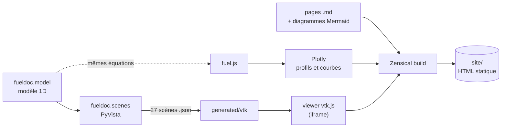

# Note de calcul interactive — crayon combustible REP

Ce site est un **démonstrateur** : il montre qu'un document d'ingénierie peut embarquer, à côté du texte et des équations, des **rendus 3D paramétriques**, des **graphiques interactifs** et des **diagrammes** — le tout versionné, reproductible et publié comme simple site statique.

L'objet d'étude est volontairement classique : la température dans un **crayon combustible de réacteur à eau pressurisée**, modèle 1D radial en régime permanent.

- :lucide-box: **[Étude paramétrique 3D](etude-parametrique.md)**

    Deux curseurs (puissance linéique, rayon de pastille) pilotent une coupe 3D PyVista colorée par la température et un profil radial Plotly recalculé en direct.

- :lucide-chart-line: **[Résultats](resultats.md)**

    Courbes de réponse, décomposition des écarts de température et surface de réponse 3D, tous interactifs (zoom, survol, rotation).

- :lucide-sigma: **[Modèle](modele.md)**

    Hypothèses, équations et chaîne de résistances thermiques, avec diagramme Mermaid.

- :lucide-git-branch: **[Reproductibilité](reproductibilite.md)**

    Chaîne de production complète, du script Python au site statique, et limites de l'approche.

## Chaîne de production

!!! warning "Périmètre"
    Le modèle est didactique (conductivités constantes, pas de gonflement ni de relocalisation, plan médian uniquement). Il illustre la **forme du livrable**, il n'a pas vocation à justifier un dimensionnement.
