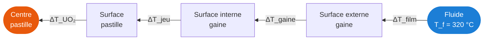

# Modèle thermique

## Hypothèses

- Régime permanent, conduction purement radiale, symétrie cylindrique.
- Génération volumique uniforme dans la pastille d'UO₂ ; la puissance linéique est notée q′ (W/m).
- Conductivités constantes : λ_UO₂ = 3 W/m/K, λ_gaine = 17 W/m/K.
- Jeu pastille-gaine représenté par une conductance d'échange h_jeu.
- Température du fluide et coefficient d'échange paroi-fluide imposés.

## Chaîne de résistances

## Équations

Avec R_f le rayon de pastille, R_ci et R_co les rayons interne et externe de gaine :

| Terme | Expression |
|---|---|
| Film caloporteur | ΔT_film = q′ / (2π · R_co · h_cool) |
| Gaine | ΔT_gaine = q′ / (2π · λ_gaine) · ln(R_co / R_ci) |
| Jeu | ΔT_jeu = q′ / (2π · R_f · h_jeu) |
| Pastille | ΔT_UO₂ = q′ / (4π · λ_UO₂) |
| Profil dans la pastille | `T(r) = T_surf + ΔT_UO₂ · (1 − r² / R_f²)` |
| Profil dans la gaine | `T(r) = T_ci − q′ / (2π · λ_gaine) · ln(r / R_ci)` |

La température au centre est la somme de T_fluide et des quatre écarts.

## Données

| Paramètre | Valeur | Statut |
|---|---|---|
| T_fluide | 320 °C | fixé |
| h_cool | 30 000 W/m²/K | fixé |
| h_jeu | 5 000 W/m²/K | fixé |
| Jeu radial | 0,08 mm | fixé |
| Épaisseur de gaine | 0,57 mm | fixé |
| Puissance linéique q′ | 10 à 50 kW/m | **paramètre** |
| Rayon de pastille R_f | 3,9 / 4,1 / 4,3 mm | **paramètre** |
| Limite de fusion UO₂ | 2 840 °C | critère (combustible neuf) |
