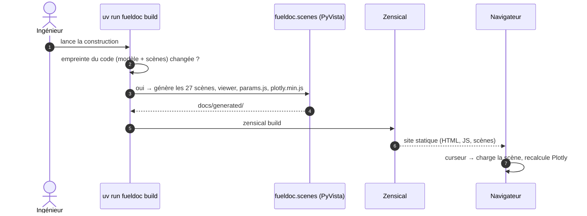

# Reproductibilité et limites

## Séquence de production



## Commandes

```bash
uv sync                      # installe PyVista, trame-pyvista, Zensical… (uv.lock)
uv run fueldoc build         # génère les ressources 3D si nécessaire, puis zensical build
uv run fueldoc serve         # idem, avec prévisualisation locale
uv run fueldoc generate --force   # régénère seulement les ressources
```

La génération est mise en cache par empreinte du code (`model.py`, `scenes.py`) : un build sans changement du modèle ne relance pas PyVista.

## Où est le « hook » ?

Zensical 0.1.x n'a pas encore d'API de hooks ni de plugins : la clé `hooks` de la configuration est acceptée mais n'exécute rien. Deux points d'accroche sont donc utilisés :

| Mécanisme | Rôle |
|---|---|
| `uv run fueldoc build` | exécute la génération **avant** `zensical build` (déterministe) |
| extension Markdown `fueldoc` | remplace le marqueur `{{ fuel_study }}` par le bloc interactif ; si les ressources manquent, les génère et signale qu'un second build est nécessaire |

Au premier build à froid, l'extension seule ne suffit pas : Zensical a déjà collecté les fichiers statiques de `docs/` quand les pages sont converties. D'où la commande `fueldoc`.

## Pourquoi pas trame directement ?

trame est un framework **serveur** : le rendu et le callback de chaque curseur s'exécutent côté Python. C'est idéal pour une application de bureau ou un déploiement dédié, mais impossible sur un hébergement statique (GitHub Pages, par exemple).

| Approche | Paramètres continus | Serveur | Usage |
|---|---|---|---|
| **Scènes précalculées** (ce site, générées au build) | grille discrète | aucun | document publié, archivable |
| trame (serveur Python) | oui | oui | outil interne, exploration libre |
| Géométrie recalculée en JS | oui | aucun | modèles simples, à réimplémenter |

## Cohérence Python / JavaScript

Le profil radial et les courbes Plotly sont recalculés dans le navigateur avec les mêmes équations que `fuelmodel.py`. Un jeu de valeurs de référence (`assets/vtk/reference.json`) permet de vérifier que les deux implémentations coïncident.

## Limites

- La vue 3D ne propose que les valeurs de la grille (9 puissances × 3 rayons) ; la caméra se réinitialise à chaque changement de scène.
- Plotly, vtk.js et Mermaid sont embarqués dans le site : aucun CDN ni police externe. Le site doit être servi en HTTP (`zensical serve`, GitHub Pages, etc.) : ouvert en `file://`, le navigateur bloque le chargement des scènes 3D.
